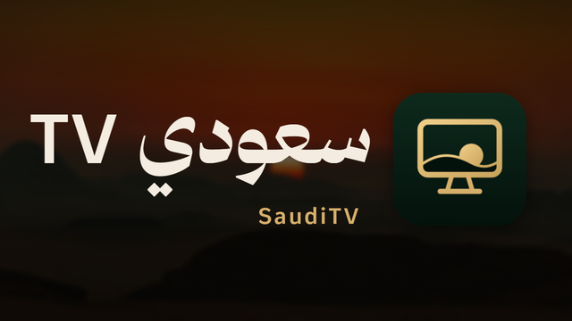
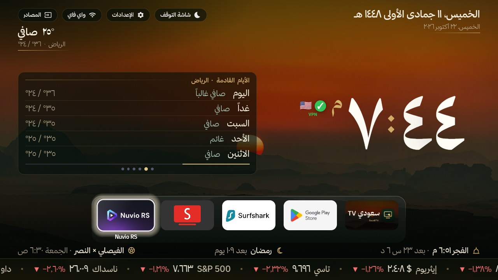
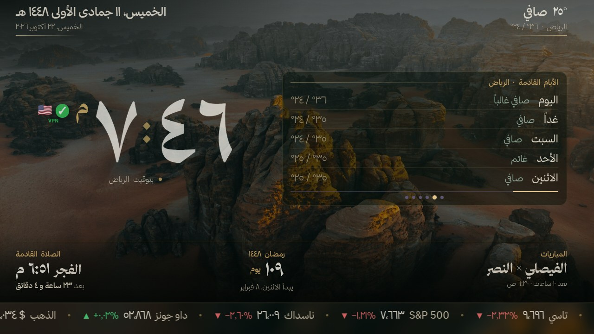
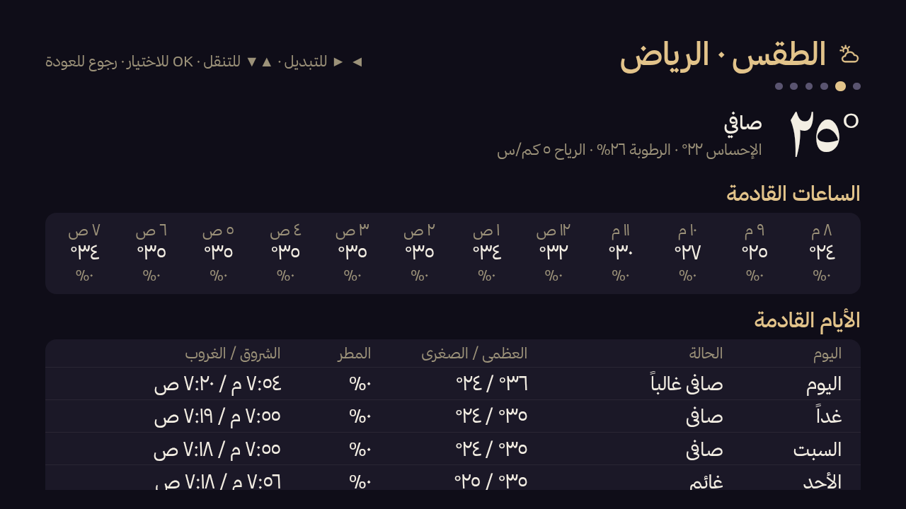
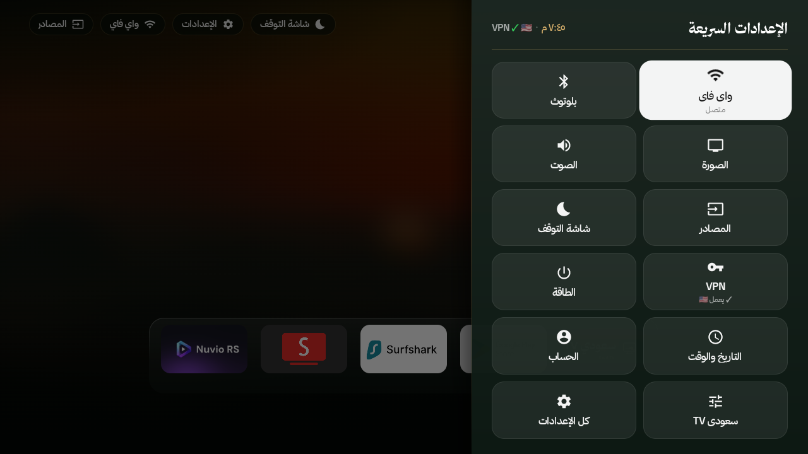

<p align="center"></p>

<h1 align="center">سعودي TV · SaudiTV</h1>

<p align="center" dir="rtl">واجهة رئيسية عربية وشاشة توقف سعودية لتلفزيونات Android TV و Google TV.</p>

<p align="center">An Arabic home screen and a Saudi screensaver for Android TV and Google TV.</p>

<p align="center"></p>

<div dir="rtl">

## وش هو

تطبيقين للتلفزيون، يركّبهم سكربت واحد من الكمبيوتر عن طريق ADB على الواي فاي:

- **شاشة التوقف «سعودي TV»** (`com.raad.sauditv.screensaver`): الساعة، التاريخ الهجري والميلادي، مواقيت الصلاة
  والإقامة، رمضان، مباريات فرقك، الطقس، الأسواق، فوق صور من السعودية.
- **الواجهة الرئيسية «سعودي TV»** (`com.raad.sauditv.home`): بنفس تصميم شاشة التوقف، مع صف المفضلة وكل التطبيقات
  والمصادر والإعدادات السريعة.

## المزايا

- **بطاقة تتبدّل كل ٣٠ ثانية** جنب الساعة، في شاشة التوقف وفي الواجهة: مواقيت اليوم، آية أو حديث اليوم، طقس الأيام
  القادمة، مباريات فرقك، ترتيب دوري روشن، أخبار السعودية، أخبار مدينتك، أخبار التقنية والذكاء الاصطناعي، جديد المسلسلات. تختار
  البطاقات وترتيبها لكل شاشة.
- **صفحات التفاصيل:** OK على البطاقة في الواجهة يفتحها على كامل الشاشة (المواقيت، الأخبار مع نص الخبر، الترتيب،
  المباريات، المسلسلات…)، ويمين ويسار يقلّبون بينها.
- **الشريط:** أسعار الأسواق تتحرك أسفل الشاشة (تاسي، S&P 500، الذهب، برنت، الدولار/الريال، بيتكوين…)، وفوقه شريط
  معلومات: الصلاة القادمة، رمضان، المباراة القادمة.
- **حماية من احتراق الشاشة:** كل ساعة تتبادل الساعة والبطاقة أماكنهم بتلاشي هادئ، دقيقة صورة بس عند :١٥ و :٤٥ (الشريط
  واقف)، إزاحة خفيفة للمحتوى، وتعتيم بالليل (من ١١ الليل إلى ٦ الصبح حوالي ٤٠٪ من السطوع).
- **الإعدادات السريعة** في الواجهة: واي فاي، بلوتوث، الصورة، الصوت، المصادر، شاشة التوقف، VPN، الطاقة، التاريخ
  والوقت، الحساب، سعودي TV، وكل الإعدادات.
- **علامة VPN** جنب الساعة (يعمل، أو متصل بدون إنترنت، أو مطفي)، ومع علم بلد الخروج في الواجهة.
- **يشتغل بدون إنترنت:** الساعة والتاريخ والمواقيت ورمضان تشتغل، وآخر بيانات تبقى على الشاشة.
- **تحديث الصفحة تلقائياً** من هذا المستودع كل ٦ ساعات، بدون إعادة تركيب.
- **تسريع التلفزيون:** إطفاء التتبّع والإعلانات والعروض (يمكن التراجع عنه)، تجميد التطبيقات المقفلة، حركة أسرع.

## صور

| | |
|---|---|
|  |  |
| شاشة التوقف | صفحة تفاصيل من البطاقة |
|  |  |
| الإعدادات السريعة | الواجهة الرئيسية |

## التركيب

1. **على التلفزيون:** الإعدادات ← النظام ← حول ← اضغط OK على **Build** سبع مرات، ثم من **خيارات المطوّر** شغّل
   **USB debugging** (و **Network debugging** إذا موجود). خلّ التلفزيون على نفس الواي فاي.
2. **على الكمبيوتر** (ويندوز: Git Bash و Python 3؛ أو ماك ولينكس):
   ```
   git clone https://github.com/raad113/SaudiTV.git && cd SaudiTV
   cp household.env.example household.env      # مدينتك، فرقك، البطاقات، المفضلة (اختياري)
   optimize/setup-new-tv.sh 192.168.x.y         # عنوان التلفزيون؛ بدونه يدوّر عليه
   ```
   أول اتصال تطلع على التلفزيون «Allow USB debugging?»: اضغط **Allow** وعلّم **Always allow**.
3. السكربت ينزّل التطبيقين من آخر إصدار في GitHub ويركّبهم ويطبّق إعداداتك، ويسأل قبل أي حذف أو تحميل إضافي.
   تجربة بدون تغيير: `--dry-run`. فحص بس: `--verify`. الشرح الكامل والتراجع: [docs/SETUP.md](docs/SETUP.md).

بدون `household.env` الإعدادات الافتراضية: الرياض، أم القرى، المنتخب والهلال والنصر والاتحاد والأهلي، وست بطاقات
(مواقيت، طقس، مباريات، ترتيب، أخبار السعودية، تقنية). الملف ما يُرفع لـ GitHub أبداً.

## التحديثات

- **الصفحة** (`dist/tv.html`): شاشة التوقف تجيبها من فرع `main` هنا كل ٦ ساعات (شغّال افتراضياً؛ يوقف من الإعدادات أو
  `optimize/saver.sh autoupdate off`). ما تقبل إلا صفحة كاملة فيها علامة البناء، ولو التطبيق أحدث من الصفحة المحمّلة يعرض
  صفحته هو. تحديث فوري: `optimize/saver.sh update`.
- **التطبيقات:** كل نسخة إصدار مرقّم في [Releases](https://github.com/raad113/SaudiTV/releases) (`v9034`…).
  `optimize/install.sh all` يركّب آخر إصدار، و `APK_TAG=v9034 optimize/install.sh all` نسخة معيّنة.
- **من التلفاز نفسه:** الإعدادات ← «تحديث التطبيق» يحدّث التطبيقين من آخر إصدار بدون كمبيوتر (يتحقق من كل ملف قبل
  التثبيت)، والواجهة الرئيسية تعرض «تحديث متوفر» لما يكون فيه جديد. الإصدار الجديد: `tools/release.sh`
  ([docs/SETUP.md](docs/SETUP.md)).

## البناء

```
python3 src/build.py                                   # src/template.html -> dist/
cd android && gradle assembleRelease                   # Gradle 8.10 + JDK 17 (Android Studio's JBR) + Android SDK
```
رقم النسخة في ملف `VERSION` (لازم يزيد كل بناء). التوقيع بمفتاح خارج المستودع في `~/.sauditv/` (التفاصيل في
[docs/SETUP.md](docs/SETUP.md))؛ بدونه البناء يتوقّع بمفتاح debug ويطبع تنبيه.

</div>

## What it is

Two TV apps, set up from a computer over ADB on the home Wi-Fi by one script:

- **The سعودي TV screensaver** (`com.raad.sauditv.screensaver`): clock, Hijri and Gregorian dates, prayer times and
  iqama, Ramadan, your teams' matches, weather and markets, over photos of Saudi Arabia.
- **The سعودي TV home screen** (`com.raad.sauditv.home`): the same design as the screensaver, with a favourites row,
  all apps, inputs and a quick-settings panel.

## Features

- **A card that rotates every 30 s** beside the clock, on the screensaver and the home screen: today's prayers, a verse
  or hadith of the day, the forecast, your teams' matches, the Saudi Pro League table, Saudi news, your city's news,
  tech and AI news, new episodes. Pick the cards and their order for each screen.
- **Detail pages:** OK on the home screen's card opens it full screen (prayers, news with the article text, the table,
  matches, episodes…); left and right step through them.
- **The ticker:** market prices move along the bottom (TASI, S&P 500, gold, Brent, USD/SAR, Bitcoin…), with an info
  strip above it: the next prayer, Ramadan, the next match.
- **Burn-in protection:** every hour the clock and the card swap sides with a slow fade, a photo-only minute at :15 and
  :45 (the ticker holds still), a small pixel shift, and night dimming (23:00 to 06:00, about 40% brightness).
- **Quick settings** on the home screen: Wi-Fi, Bluetooth, picture, sound, inputs, screensaver, VPN, power, date and
  time, account, سعودي TV and all settings.
- **A VPN mark** beside the clock (working, connected but no traffic, or off), and the exit country's flag on the home
  screen.
- **Works offline:** clock, dates, prayer times and Ramadan keep going; the last good data stays on screen.
- **The page updates itself** from this repository every 6 hours, without a reinstall.
- **A safe TV speed-up:** telemetry, ads and demos off (reversible), closed apps frozen, faster animations.

## Install

1. **On the TV:** Settings → System → About → press OK on **Build** 7 times, then in **Developer options** turn on
   **USB debugging** (and **Network debugging** if listed). Keep the TV on the same Wi-Fi.
2. **On a computer** (Windows: Git Bash and Python 3; or macOS / Linux):
   ```
   git clone https://github.com/raad113/SaudiTV.git && cd SaudiTV
   cp household.env.example household.env      # your city, teams, cards, favourites (optional)
   optimize/setup-new-tv.sh 192.168.x.y         # the TV's address; without it the script looks for the TV
   ```
   On the first connection the TV asks «Allow USB debugging?»: press **Allow** and tick **Always allow**.
3. The script downloads both apps from the latest GitHub release, installs them, applies your settings, and asks before
   removing anything or downloading extras. `--dry-run` shows what it would do, `--verify` only checks. Full guide and
   undo: [docs/SETUP.md](docs/SETUP.md).

Without `household.env` the defaults are public ones: Riyadh, Umm al-Qura, the national team, Al-Hilal, Al-Nassr,
Al-Ittihad and Al-Ahli, and six cards (prayers, forecast, matches, table, Saudi news, tech). git never tracks that file.

## How updates work

- **The page** (`dist/tv.html`): the screensaver fetches it from this repository's `main` branch every 6 hours (on by
  default; off in its settings or with `optimize/saver.sh autoupdate off`). It only accepts a whole page carrying the
  build's marker, and a page downloaded before the app was installed or updated is ignored: the app's own copy is newer.
  Update now: `optimize/saver.sh update`. The home screen shows the page bundled in its own APK.
- **The apps:** every build is a numbered [release](https://github.com/raad113/SaudiTV/releases) (`v9034`, …) with
  `saudi-tv-screensaver.apk`, `saudi-tv-home.apk` and `update.json`. `optimize/install.sh all` installs the latest one
  (`releases/latest/download/…`); `APK_TAG=v9034 optimize/install.sh all` a given one.
- **From the TV itself:** settings > «تحديث التطبيق» updates both apps from the latest release without a PC (every file
  is checked before it is installed), and the home screen shows «تحديث متوفر» when there is one. A new release:
  `tools/release.sh` ([docs/SETUP.md](docs/SETUP.md)).

## Build

```
python3 src/build.py                                   # src/template.html -> dist/saudi-tv.html and dist/tv.html
cd android && gradle assembleRelease                   # Gradle 8.10, JDK 17 (Android Studio's JBR), Android SDK
```
- **Version:** the `VERSION` file (one number) is the versionCode and versionName of both apps and the release
  tag (`v9035`). Raise it for every build you install: Android refuses a downgrade. `VERSION_CODE` (or CI's
  `GITHUB_RUN_NUMBER`) in the environment overrides it for one build.
- **Signing:** both apps are signed with the project's release key, kept **outside** the repository in
  `~/.sauditv/` (`sauditv-release.jks` and `keystore.properties`). Without it, release builds get the debug key and
  Gradle says so; such APKs can't update apps installed from the releases. Back-up rules: [docs/SETUP.md](docs/SETUP.md).
- Full commands (Windows paths included), and how to publish a release: [docs/SETUP.md](docs/SETUP.md).

```
src/template.html     the screen (HTML/CSS/JS, no framework); edit it, then run src/build.py
dist/                 saudi-tv.html (stand-alone, opens in any browser) and tv.html (the page the apps load)
android/app           the screensaver app: DreamService, settings, page auto-update
android/launcher      the home screen: dock, apps grid, quick settings, the card and its detail pages
assets/ photos/       fonts, bundled and hosted photos, Arabic team names, verse and hadith texts
optimize/             TV tools over ADB (pure Python, no adb binary): setup-new-tv.sh, install.sh, saver.sh, dock.sh…
.github/tools/        data tools (verses, hadith checks, clubs, photos), run by hand
tools/release.sh      a new release: version, build, update.json (what the apps' in-app update reads), tests, GitHub
tests/                checks: build, data, fonts, scripts, private data, the page in a browser
```

**Data** (free, no keys): Aladhan (prayer times), Open-Meteo (weather), Yahoo and CoinGecko (markets), TVMaze
(episodes), TheSportsDB and ESPN (matches and the table), news feeds (Asharq Al-Awsat, Al Arabiya, Google News, BBC
Arabic). Verse and hadith texts are never typed by hand: verses come from the Quran API
(`.github/tools/fetch_verses.py`) and each hadith is checked against the six books (`.github/tools/verify_hadith.py`).

## Credits · الشكر

- Based on UrTV by tshi-dev, (portions © tshi-dev).
- Home screen adapted from [mihirgupta0900/tv-home](https://github.com/mihirgupta0900/tv-home) (MIT,
  [android/launcher/LICENSE-tv-home](android/launcher/LICENSE-tv-home)).
- Photos: Unsplash photographers, listed in [docs/PHOTO-CREDITS.md](docs/PHOTO-CREDITS.md).
- Fonts: Thmanyah (by Thmanyah), and Noto Naskh Arabic for ﷺ ﴿﴾ (SIL Open Font License,
  `assets/fonts/NotoNaskhArabic-OFL.txt`).
- Package safety ratings from [UAD-ng](https://github.com/Universal-Debloater-Alliance/universal-android-debloater-next-generation).

## License

The project's own work is under the MIT license, see [LICENSE](LICENSE). The parts listed under Credits keep their own
licenses and permissions.
